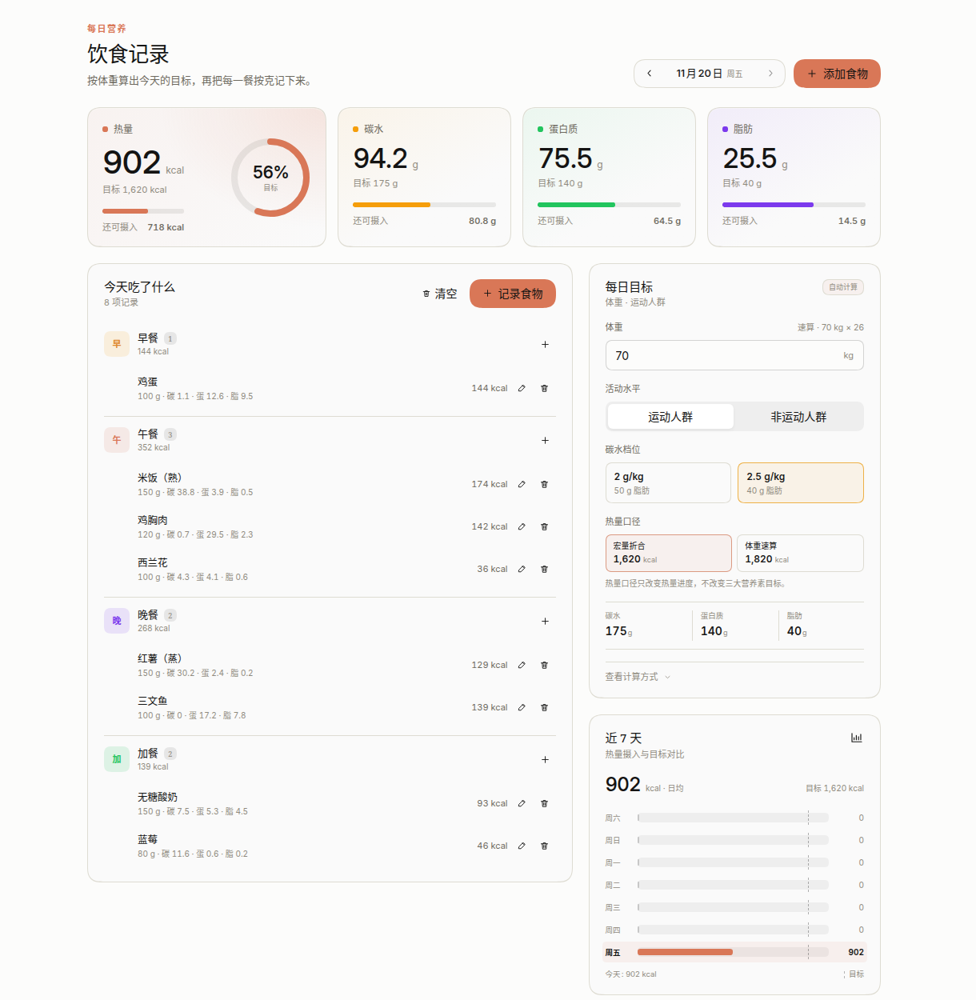
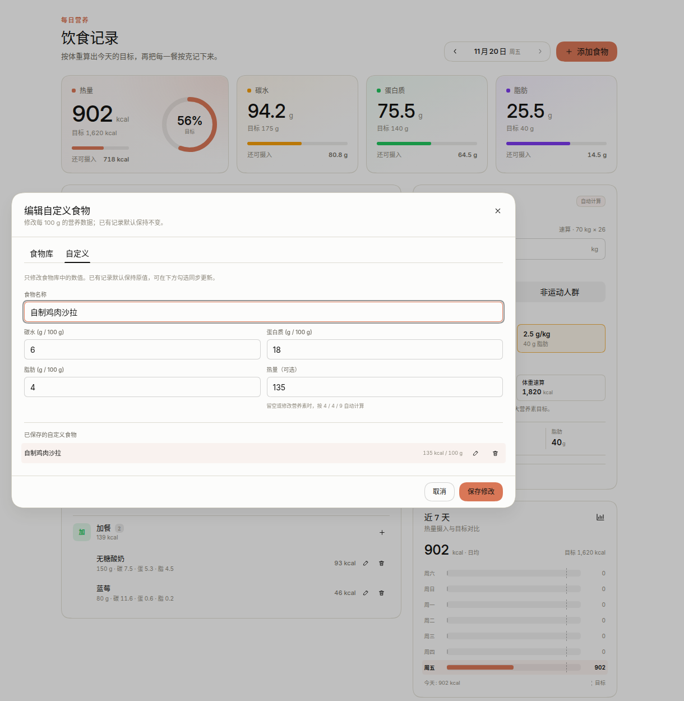

# dsh-diet

[简体中文](README.md) · English

[](https://www.npmjs.com/package/dsh-diet)


[](https://github.com/PandaAB/dsh-diet/actions/workflows/ci.yml)
[](https://github.com/PandaAB/dsh-diet)

> Still stepping on the scale every morning and wondering why the number will not move?
>
> Still living on boiled chicken, cutting carbs, and raiding the fridge at midnight?
>
> Still eating by feel — not enough protein, too much fat, weight bouncing up and down?
>
> The hard part of a diet is rarely “eat less”. It is **knowing how much to eat each day**.
>
> `dsh-diet` turns the **foolproof formula** shared by Douyin creator **零重力R哥** into a practical food-log page.
>
> For people cutting weight who do not want to recalculate macros every day: enter your weight, choose active or less active, and your targets appear; log what you ate by grams and see what is left.



> The formula comes from a public post by Douyin creator 零重力R哥. This project is an independent open-source implementation, not an official product or medical advice.

## What it does

A diet needs a starting point you can actually follow, not guesswork:

- Turn body weight and activity into daily carbohydrate, protein and fat targets.
- View calories against either macro-derived calories or the quick body-weight formula.
- Log meals by grams and watch today's remaining targets update.
- Use a seven-day chart, edit entries, undo deletes, and clear a day with confirmation.

## Who it is for

- People cutting or managing their weight who want to log food honestly;
- People who do not want to recalculate macros with a calculator every day;
- People who prefer keeping body weight and food logs in their own browser;
- People who want a simple rule to start with, then adjust based on real-world results.

## Read this first

- **This is not magic and not a medical prescription.** It is an everyday estimate and a logging tool.
- Minors, pregnant or breastfeeding people, people with diabetes, kidney disease or other conditions, and anyone with a history of disordered eating should talk to a doctor or registered dietitian first.
- Do not treat very-low-calorie dieting, cutting carbs completely, or eating only boiled vegetables as a long-term plan. If your calculated target stays below roughly 1200 kcal/day for women or 1500 kcal/day for men, be careful and seek professional guidance if needed.
- A loss of about 0.5%–1% of body weight per week is usually more sustainable than chasing a huge drop in a week. The goal is adherence, not punishment.
- Food values are general references. Use nutrition labels for packaged food; sweet potato, meat and many other foods vary by variety, cut and cooking method. Use **Edit as custom food** to save your own accurate version.

## The “foolproof formula”

For body weight `w` kg:

| Group | Carbs | Protein | Fat | Quick calories |
| --- | --- | --- | --- | --- |
| Active | 2.0 or 2.5 g/kg | 2.0 g/kg | 50 g with 2.0 g/kg carbs; 40 g with 2.5 g/kg | `w × 26` |
| Less active | 1.5 or 2.0 g/kg | 1.5 g/kg | 50 g with 1.5 g/kg carbs; 40 g with 2.0 g/kg | `w × 24` |

- Higher-carb days pair with 40 g fat; lower-carb days pair with 50 g fat.
- Macro calories use 4 kcal/g for carbohydrate and protein, 9 kcal/g for fat.
- The quick-calorie view is a reference only; switching views changes the calorie target, not the macro targets.

### Formula source

- Douyin creator **零重力R哥**: <https://www.douyin.com/video/6838903595832757516>
- This project is an independent implementation of a publicly shared formula. It is **not affiliated with or endorsed by** the creator.
- If you change your diet based on the formula, watch body weight, measurements, training performance and how you feel — not just one day's scale reading.

## Features

- **Targets from body weight** — enter weight, activity group and carb level; targets update immediately.
- **Two calorie views** — macro-derived calories or the quick formula (active × 26, less active × 24 kcal/kg).
- **Food log by grams** — 25 built-in foods, searchable and grouped by category, plus custom foods with per-100 g nutrition.
- **Meals and days** — breakfast / lunch / dinner / snack, previous/next day, seven-day chart, edit, delete with undo, guarded clear-day.
- **Custom food editing** — update per-100 g values and optionally sync past entries. Built-in presets are reference values; use **Edit as custom food** to save your own version.
- **Bilingual UI** — English and Simplified Chinese, following the Harness language. Chinese is the primary project language; this file is the English companion.
- **Local-first** — settings, custom foods and logs live in `localStorage`; nothing is sent to a model or server.

## Install

### From npm

```sh
npm install -g @deepseek-ai/dsh   # once, if dsh is not already installed
dsh plugin --profile web add dsh-diet
```

Or open **Plugins → Add plugin**, search for `dsh-diet`, and install it.

After installation, refresh the Web GUI. The entry appears in the sidebar as **Daily intake** (or **饮食记录** in Chinese).

### From a local checkout

```sh
dsh plugin --profile web add /absolute/path/to/dsh-diet
```

Or use **Plugins → Add plugin** and choose the checkout directory. A linked checkout picks up `lib/client.js` changes through the client watcher.

## Use

1. Open **Daily intake** from the sidebar.
2. On first run, click **Set weight** in the banner, enter your body weight in kilograms, and confirm.
3. Choose activity level and carb level. The paired fat target is shown on each choice.
4. Click **Add food**, choose a built-in or custom food, set grams and meal, and add it.
5. Edit an entry by clicking its row; delete with the trash button (undo is available).
6. Click a row in **Last 7 days** to jump to that day.

### Editing food data

- Custom foods have a pencil button in the **Custom** tab and in the selected-food panel. Editing changes future entries. Past entries keep their values unless **Also update logged entries** is checked.
- Built-in foods are reference values, not a claim of exactness. A sweet potato differs by variety, cut and cooking method. Select a preset and click **Edit as custom food** to save a corrected version; the preset remains untouched.
- Deleting a custom food never rewrites existing log entries.



## Data and privacy

The state key is `dsh-diet:state:v1` in the browser's `localStorage`.

- No account, sync or cloud backup.
- No model requests and no food/body-weight data sent anywhere.
- Removing the plugin or clearing site data removes the log.
- The key is per browser origin; a different DSH port or browser starts fresh.

## Development

Requirements: Node 22.19+ or 24+.

```sh
npm install
npm run build      # src/client.jsx -> lib/client.js
npm test           # rebuild and validate manifest/resources/locales/bundle
npm run pack:check # inspect the npm tarball
```

The browser entry is built with esbuild into the DSH `window.__ModuleLoader__.load` format. `src/foods.js` holds preset nutrition data, `src/locales.js` holds UI dictionaries, `src/client.jsx` owns the page, and `src/styles.js` holds the scoped stylesheet using DSH theme tokens.

The Host half is a no-op Cordis plugin (`index.js`); all behavior is in the browser entry.

## Compatibility

- `@deepseek-ai/dsh` `>=0.2.0-rc.2`
- Web client with sidebar panel slots and the locale service
- Node `^22.19.0 || >=24.0.0` for building

## Contributing and releasing

Issues and pull requests are welcome. See [CONTRIBUTING.md](CONTRIBUTING.md) and [RELEASING.md](RELEASING.md).

## Credits

- Formula: the “foolproof formula” publicly shared by Douyin creator **零重力R哥**.
- Built as a plugin for [DeepSeek Harness](https://deepseek.com/harness/), using its theme tokens and slot system.

## License

[MIT](LICENSE) © 2026 dsh-diet contributors.
