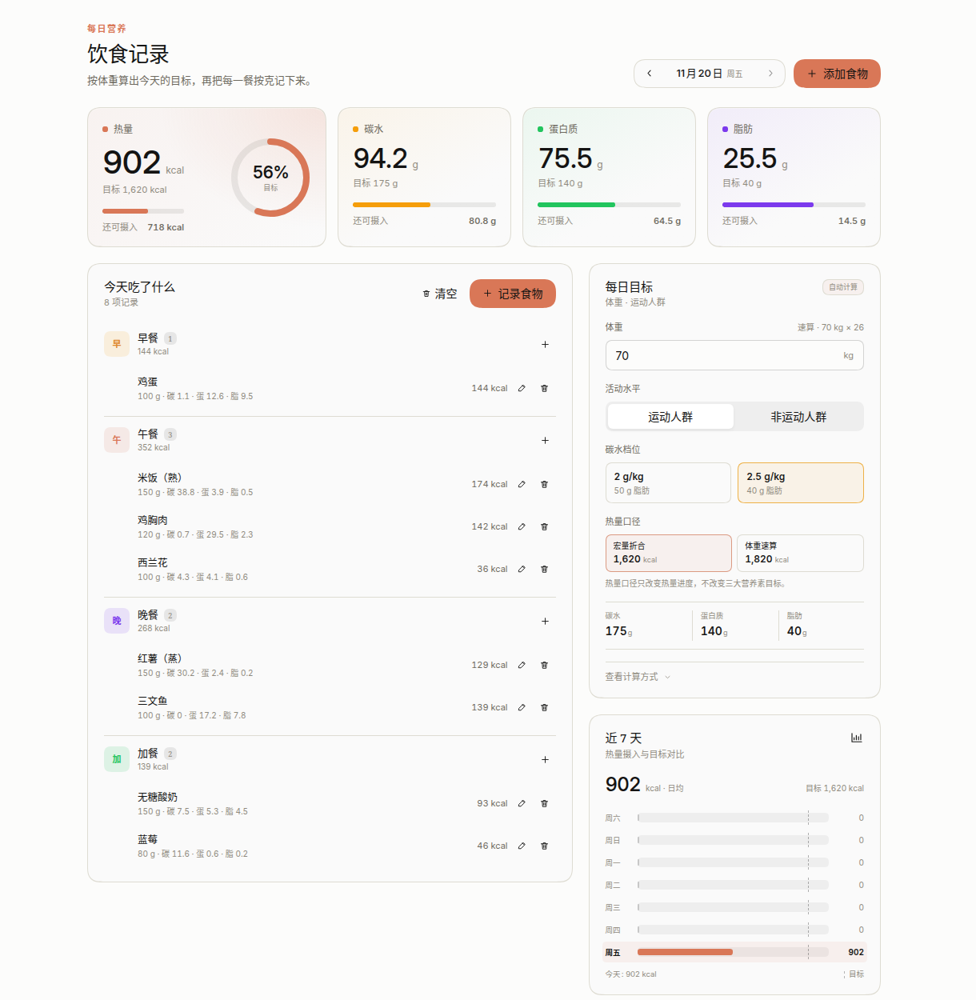
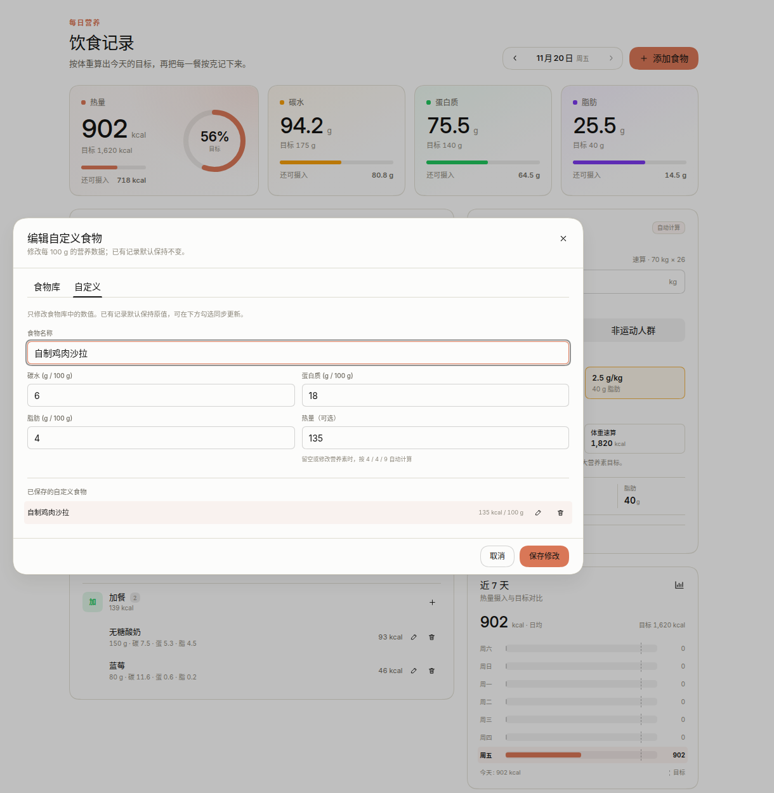

# dsh-diet

[简体中文](README.md) · [English](README.en.md)


[](https://github.com/PandaAB/dsh-diet/actions/workflows/ci.yml)
[](https://github.com/PandaAB/dsh-diet)

> **还在不知道怎么减重吗？还在不知道怎么吃、怎么练、怎么坚持吗？**
>
> 别急着办卡，别急着买代餐，先把每天该吃多少算明白。
>
> 还在每天上秤，数字不动就怀疑人生？
>
> 还在水煮鸡胸、断碳水、饿到半夜翻冰箱？
>
> 还在跟着感觉吃，蛋白质不够、脂肪乱堆、体重反复横跳？
>
> 节食减重最难的，不是“少吃”，而是**每天到底该吃多少**。
>
> 这个插件把抖音「零重力R哥」的**“傻瓜公式”**做成了一个顺手的小工具：输入体重，选运动/非运动，目标直接出来；吃了什么、多少克，记一下，今天还剩多少一目了然。



> 公式来自抖音「零重力R哥」的公开分享；本项目是独立的开源实现，不是官方产品，也不构成医疗建议。

## 它解决什么

减脂不是把饭量砍半，也不是永远水煮菜。你需要一个**能执行、能看见、不用每天重新算**的起点：

- 按体重和活动量，直接算出每天的碳水、蛋白质和脂肪目标；
- 用“宏量折合”或“体重速算”两种口径看热量；
- 按克记录每一餐，今天的余量实时更新；
- 7 天趋势、编辑、删除撤销、清空确认，避免“记着记着就放弃”。

## 适合谁

- 正在减脂、控制体重，想认真记录饮食的朋友；
- 不想每天拿计算器算宏量营养素的人；
- 不想把体重和饮食数据上传到某个 App 的人；
- 想用一个简单规则先跑起来，再根据体重变化调整的人。

## 先说清楚

- **这不是魔法，也不是医学处方。** 公式来自博主分享，适合作为日常估算和记录起点。
- 未成年人、孕期/哺乳期、有糖尿病/肾病等慢性病、有进食障碍史的人，请先咨询医生或注册营养师。
- 不建议长期极低热量、断碳水或只吃水煮菜。如果算出来的目标热量长期低于女性 1200 kcal / 男性 1500 kcal，请谨慎对待，必要时寻求专业帮助。
- 体重每周下降 0.5%–1% 左右通常比“一周掉十斤”更可持续。目标是能坚持，不是把自己饿到失控。
- 食物数据是常见参考值。包装食品看营养成分表；红薯、肉类等品种和做法差异很大，用 **修改并保存为自定义** 保存你自己的版本。

## “傻瓜公式”

体重 `w` kg：

| 人群 | 碳水 | 蛋白质 | 脂肪 | 热量速算 |
| --- | --- | --- | --- | --- |
| 运动人群 | `2.0` 或 `2.5 g/kg` | `2.0 g/kg` | 低碳水配 50 g；高碳水配 40 g | `w × 26` |
| 非运动人群 | `1.5` 或 `2.0 g/kg` | `1.5 g/kg` | 低碳水配 50 g；高碳水配 40 g | `w × 24` |

- 碳水档位和脂肪联动：低碳水配 50 g 脂肪，高碳水配 40 g 脂肪。
- 宏量热量按碳水 4 kcal/g、蛋白质 4 kcal/g、脂肪 9 kcal/g 计算。
- “热量速算”只作为参考，不参与三大营养素目标的推导；切换口径只改变热量进度。

### 公式来源

- 抖音「零重力R哥」：<https://www.douyin.com/video/6838903595832757516>
- 本项目只是把公开分享的公式做成 DSH 插件，**非官方、无隶属关系**。
- 如果你根据公式调整了饮食，建议同时观察体重、围度、训练表现和精神状态，不要只看一天的秤。

## 功能

- **按体重出目标**：输入体重，选运动/非运动、碳水档位，目标即时更新。
- **两种热量口径**：宏量折合，或体重速算（运动 `×26`、非运动 `×24`）。
- **按克记录**：24 种内置食物，支持搜索和分类，也可以创建自定义食物。
- **按餐、按天**：早餐/午餐/晚餐/加餐，前后切换日期，近 7 天热量趋势，编辑、删除撤销、清空确认。
- **自定义食物可改**：修改每 100 g 数值，可选是否同步历史记录；内置食物用“修改并保存为自定义”保存自己的版本。
- **中英文界面**：跟随 Harness 语言；代码和文档中文优先，英文辅助。
- **本地优先**：数据保存在浏览器 `localStorage`，不上传，不调用模型。

## 安装

### 从 npm 安装

```sh
npm install -g @deepseek-ai/dsh   # 如果还没装 dsh
dsh plugin --profile web add dsh-diet
```

也可以打开 **插件 → 添加插件**，搜索 `dsh-diet` 安装。

> 如果 npm 上还没有 `dsh-diet`，请先用下面的本地目录安装。

安装后刷新页面，左侧会出现 **饮食记录**（英文界面为 **Daily intake**）。

### 本地目录安装

```sh
dsh plugin --profile web add /绝对路径/dsh-diet
```

或使用 **插件 → 添加插件** 选择这个目录。软链接安装会跟随 `lib/client.js` 的改动。

## 使用

1. 从左侧打开 **饮食记录**。
2. 第一次使用时点击提示条里的 **设置体重**，输入公斤数并确认。
3. 选择活动水平和碳水档位；脂肪目标会跟着档位显示。
4. 点 **添加食物**，从内置或自定义食物中选择，填克数和餐次。
5. 点击记录行可编辑克数/餐次；垃圾桶删除，可撤销。
6. 点 **近 7 天** 里的某一天可跳转。

### 修改食物数据

- 自定义食物在 **自定义** 标签和已选食物面板里有铅笔按钮。修改只影响以后的记录；历史记录默认不动，勾选 **同时更新已记录的 N 条数据** 才会同步。
- 内置食物是通用参考值，不同品种、部位、生熟方式和品牌都会有差异。选中内置食物后点 **修改并保存为自定义**，保存自己的版本，预设本身不会被改。
- 删除自定义食物不会改写已有记录。



## 数据与隐私

状态保存在浏览器 `localStorage` 的 `dsh-diet:state:v1`。

- 无账号、无云同步。
- 不调用模型，不发送饮食或体重数据。
- 删除插件或清除站点数据会删除记录。
- 不同浏览器或不同 DSH 端口的数据相互独立。

## 开发

需要 Node 22.19+ 或 24+。

```sh
npm install
npm run build      # src/client.jsx -> lib/client.js
npm test           # 重新构建并校验清单、资源、语言包、bundle 语法
npm run pack:check # 查看 npm 包内容
```

浏览器入口用 esbuild 构建为 DSH 的 `window.__ModuleLoader__.load` 格式。`src/foods.js` 是内置食物数据，`src/locales.js` 是中英文文案，`src/client.jsx` 是页面逻辑，`src/styles.js` 是只用 DSH 主题 token 的样式。

Host 半部分是空的 Cordis 插件（`index.js`），功能都在浏览器端。

## 兼容性

- `@deepseek-ai/dsh` `>=0.2.0-rc.2`
- 支持侧边栏 panel slot 和 locale service 的 Web 客户端
- 构建环境 Node `^22.19.0 || >=24.0.0`

## 贡献与发布

欢迎提 issue 或 PR，见 [CONTRIBUTING.md](CONTRIBUTING.md)。发布流程见 [RELEASING.md](RELEASING.md)。

## 致谢

- 公式来源：抖音「零重力R哥」的“傻瓜公式”。
- 界面运行在 [DeepSeek Harness](https://deepseek.com/harness/) 中，使用其主题 token 和 slot 机制。

## 许可

[MIT](LICENSE) © 2026 dsh-diet contributors。
