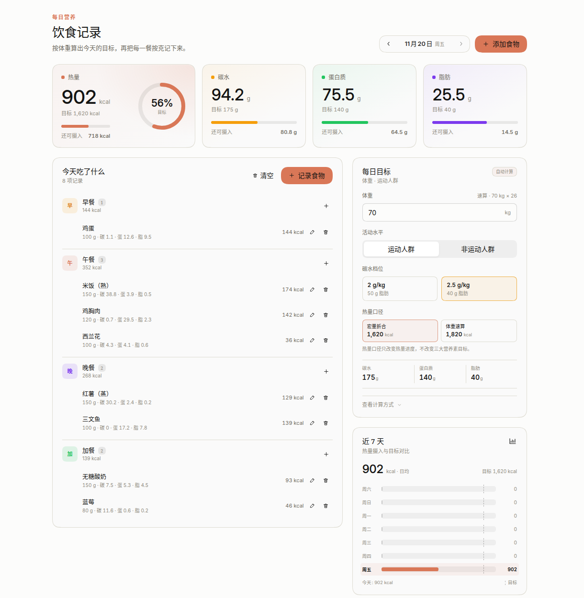
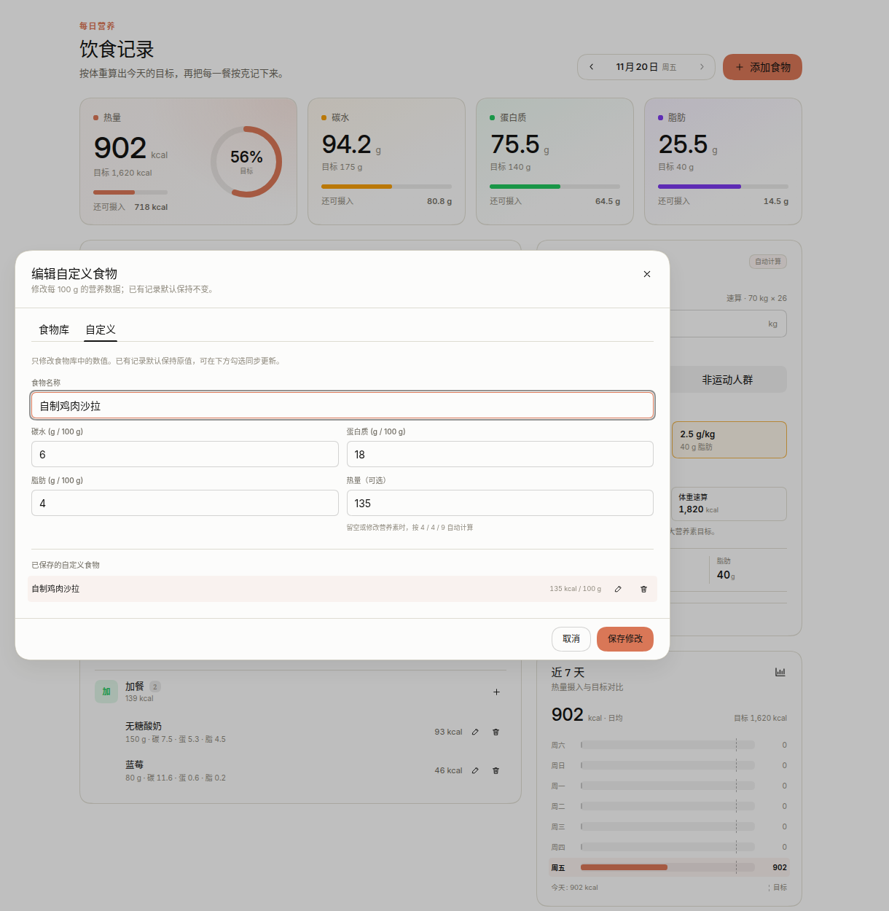

# dsh-diet

为 [DeepSeek Harness](https://deepseek.com/harness/) 提供的每日营养目标与按克饮食记录插件。

[English](README.md) · [简体中文](README.zh.md)


输入体重和活动量，自动算出每天的碳水、蛋白质和脂肪目标，再按克记录你实际吃下的食物。



## 功能

- **按体重出目标**：运动人群碳水 `2.0–2.5 g/kg`、蛋白质 `2.0 g/kg`、脂肪 `50–40 g`；非运动人群碳水 `1.5–2.0 g/kg`、蛋白质 `1.5 g/kg`、脂肪 `50–40 g`。
- **两种热量口径**：宏量折合，或体重速算（运动 `×26`、非运动 `×24`）。切换只改变热量目标，不影响三大营养素目标。
- **按克记录**：24 种内置食物，支持搜索和分类，也可以创建自定义食物。
- **按餐、按天**：早餐/午餐/晚餐/加餐，前后切换日期，近 7 天热量趋势，编辑、删除撤销、清空确认。
- **自定义食物可改**：修改每 100 g 数值，可选择是否同步历史记录。内置食物是固定参考值，用“修改并保存为自定义”保存自己的版本。
- **中英文界面**：跟随 Harness 语言。
- **本地优先**：数据保存在浏览器 `localStorage`，不上传，不调用模型。

## 安装

### 从 npm 安装

```sh
npm install -g @deepseek-ai/dsh
dsh plugin --profile web add dsh-diet
```

也可以打开 **插件 → 添加插件**，搜索 `dsh-diet` 安装。

安装后刷新页面，左侧会出现 **饮食记录**（英文界面为 **Daily intake**）。

### 本地目录安装

```sh
dsh plugin --profile web add /绝对路径/dsh-diet
```

或使用 **插件 → 添加插件** 选择这个目录。

## 使用

1. 从左侧打开 **饮食记录**。
2. 第一次使用时点击提示条里的 **设置体重**，输入公斤数并确认。
3. 选择活动水平和碳水档位；脂肪目标会跟着档位显示。
4. 点 **添加食物**，从内置或自定义食物中选择，填克数和餐次。
5. 点击记录行可编辑克数/餐次；垃圾桶删除，可撤销。
6. 点 **近 7 天** 里的某一天可跳转。

### 修改食物数据

- 自定义食物在 **自定义** 标签和已选食物面板里有铅笔按钮。修改只影响以后的记录；历史记录默认不动，勾选 **同时更新已记录的 N 条数据** 才会同步。
- 内置食物是通用参考值，不同品种、部位、生熟方式和品牌都会有差异。选中内置食物后点 **修改并保存为自定义**，保存自己的版本，预设本身不会被改。
- 删除自定义食物不会改写已有记录。



## 计算公式

体重 `w` kg：

| 人群 | 碳水 | 蛋白质 | 脂肪 | 热量速算 |
| --- | --- | --- | --- | --- |
| 运动人群 | `2.0` 或 `2.5 g/kg` | `2.0 g/kg` | 低碳水配 50 g；高碳水配 40 g | `w × 26` |
| 非运动人群 | `1.5` 或 `2.0 g/kg` | `1.5 g/kg` | 低碳水配 50 g；高碳水配 40 g | `w × 24` |

宏量热量按碳水 4 kcal/g、蛋白质 4 kcal/g、脂肪 9 kcal/g 计算。体重速算只作为参考，不参与宏量目标推导。

公式和食物数据都是日常估算，不构成医疗或营养建议。

## 数据与隐私

状态保存在浏览器 `localStorage` 的 `dsh-diet:state:v1`。

- 无账号、无云同步。
- 不调用模型。
- 删除插件或清除站点数据会删除记录。
- 不同浏览器或不同 DSH 端口的数据相互独立。

## 开发

需要 Node 22.19+ 或 24+。

```sh
npm install
npm run build      # src/client.jsx -> lib/client.js
npm test           # 重新构建并校验清单、资源、语言包、bundle 语法
npm run pack:check # 查看 npm 包内容
```

浏览器入口用 esbuild 构建为 DSH 的 `window.__ModuleLoader__.load` 格式。`src/foods.js` 是内置食物数据，`src/locales.js` 是中英文文案，`src/client.jsx` 是页面逻辑，`src/styles.js` 是只用 DSH 主题 token 的样式。

Host 半部分是空的 Cordis 插件（`index.js`），功能都在浏览器端。

## 兼容性

- `@deepseek-ai/dsh` `>=0.2.0-rc.2`
- 支持侧边栏 panel slot 和 locale service 的 Web 客户端
- 构建环境 Node `^22.19.0 || >=24.0.0`

## 贡献

欢迎提 issue 或 PR，见 [CONTRIBUTING.md](CONTRIBUTING.md)。发布流程见 [RELEASING.md](RELEASING.md)。

## 许可

[MIT](LICENSE) © 2026 dsh-diet contributors。
